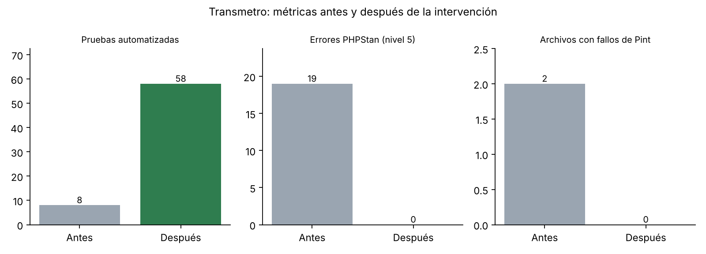

# Reporte de Mejora (antes vs. después)

Comparativa de métricas entre el estado original del proyecto (ver `Linea-Base-Calidad.md`) y el estado final, medido con el pipeline de GitHub Actions y SonarQube Cloud.

## Resumen de métricas

| Métrica | Antes | Después | Mejora |
|---|---|---|---|
| Pruebas totales | 8 | 58 (ver `Matriz-Pruebas.md`) | +50 |
| Pruebas unitarias propias | 0 | 15 | +15 |
| Pruebas de regresión dedicadas | 0 | 6 | +6 |
| Cobertura de líneas (SonarQube Cloud, 569 líneas por cubrir) | No medida | 61.3 % (umbral del plan: ≥ 60 %). PHPUnit/Clover: 66.26 % | Cumple el umbral |
| Archivos con violaciones de estilo (Pint) | 2 | 0 (gate en CI) | -2 |
| Errores PHPStan nivel 5 | 19 | 0 (gate en CI) | -19 |
| Quality Gate de SonarQube Cloud | No existía | Passed | Nuevo |
| Pipeline CI/CD | No | Sí (build, test, analyze, report) | Nuevo |
| Rama `main` protegida | No | Sí (PR obligatorio y 5 checks requeridos) | Nuevo |

Las métricas de vulnerabilidades, bugs y duplicación de SonarQube Cloud no se comparan en esta tabla porque el alcance del análisis cambió (ver la nota siguiente).

## Nota sobre las métricas de SonarQube Cloud

El primer análisis (automático, 3.2k líneas) incluía las vistas Blade y reportó Security 12, Reliability 82, Maintainability 1 y duplicación 0.9 %. El análisis ejecutado desde el pipeline excluye `resources/views/**` (plantillas HTML mezcladas con PHP) por configuración en `sonar-project.properties`, analiza 1.5k líneas de PHP y reporta 0 issues y 0.0 % de duplicación. **La diferencia se debe a la exclusión de las vistas del análisis y no a correcciones del código**; los issues de las vistas siguen sin revisar. Las correcciones reales de esta intervención son las de Pint (2 archivos) y Larastan (19 errores), más las pruebas y el pipeline.

## Nota sobre la cobertura

Un primer análisis en SonarQube dio 45.0 % sobre 775 líneas porque contaba `routes`, migraciones y seeders, que PHPUnit no medía. Se alineó el alcance (`phpunit.xml` incluye `app` y `routes`; `sonar-project.properties` excluye `database/**` de la cobertura) y el análisis posterior dio 61.3 % sobre 569 líneas. El cambio es de alcance de medición, no de pruebas nuevas.

## Issues corregidos

| Issue | Severidad | Herramienta | Corrección |
|---|---|---|---|
| Imports desordenados en `app/Models/User.php` | Menor | Pint | Reordenados (`ordered_imports`) |
| `bootstrap/app.php`: nombre de clase completo e imports desordenados | Menor | Pint | Import de `Rol` agregado y ordenado |
| Relaciones Eloquent sin tipos genéricos en los 15 modelos de `app/Models/` (`BelongsTo`, `HasMany`, `BelongsToMany`, `HasManyThrough`, `HasOne`) | Media | Larastan / PHPStan nivel 5 | Docblocks `@return Relación<Modelo, $this>` en cada relación |
| Acceso a `->pivot->orden` sin tipo conocido en `LineaController` (2 lugares) | Media | Larastan | `->firstOrFail()->pivot->getAttribute('orden')` |
| `catch (QueryException)` que PHPStan considera inalcanzable en `EstacionController` y `MunicipalidadController` | Menor | Larastan | Se conserva el `catch` (protege contra la restricción de BD) con `// @phpstan-ignore catch.neverThrown` y justificación |
| `abort_unless` con un objeto en `PanelEstacionController` | Media | Larastan | Condición explícita: `abort_unless($user->operador !== null, 403, ...)` |
| Pruebas de reportes MySQL no se ejecutaban en CI ("No tests executed") | Mayor | GitHub Actions | Atributo `#[Group('mysql')]` de PHPUnit 12 en lugar de la anotación `@group` |
| Cobertura de SonarQube (45 %) distinta de la de PHPUnit (66 %) | Mayor | SonarQube Cloud | Alineación del alcance en `phpunit.xml` y `sonar-project.properties` |
| Workflow `ci.yml` con caracteres dañados y versión fija de Larastan que fallaba al instalar | Mayor | GitHub Actions | Codificación UTF-8 corregida; instalación de Larastan sin restricción de versión |
| Nombres de checks requeridos en la regla de `main` distintos de los reales (merge bloqueado con todo en verde) | Mayor | GitHub (ruleset) | Se reemplazaron por los nombres exactos de los 5 checks del pipeline |

## Evidencia de que el pipeline bloquea código defectuoso

Se abrió el PR #2 con un test roto de forma intencional. El job `Test` falló, `Analyze` se omitió y GitHub bloqueó el merge. El PR se cerró sin mergear. Capturas en `evidencias/12-pr-bloqueado-por-test-fallido.jpg` y `evidencias/13-log-test-fallido.jpg`.
